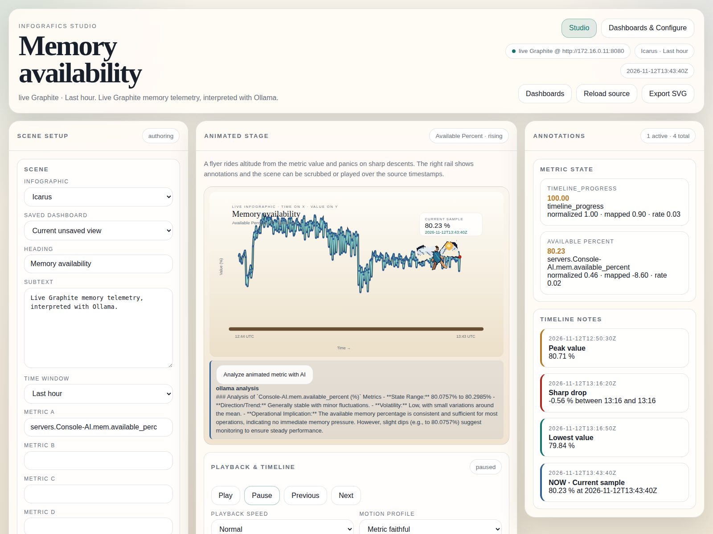
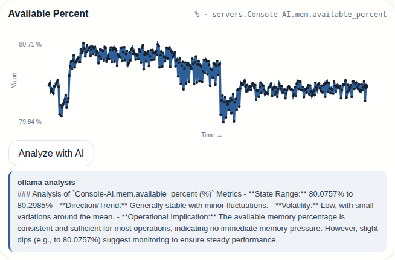

# Infografics

Infografics turns timestamped telemetry into deterministic animated infographics. Time, value, trend, and events are normalized first, then mapped to charts, characters, paths, scale, altitude, rotation, and other explicit scene properties.



## Screenshots

| Studio playback | Canonical scene state | AI metric analysis |
| --- | --- | --- |
| [Open full-size screenshot](docs/screenshots/studio-infografics.png) | [Open full-size screenshot](docs/screenshots/studio-canonical-state.png) | [View AI analysis screenshots](#ai-metric-analysis) |

The screenshots are committed under `docs/screenshots/` so they render offline in repository browsers.

## Included

- Go REST backend with an embedded Studio UI.
- SQLite control-plane store for configuration, saved dashboards, and revisions.
- Full Graphite branch discovery and replay using only source-reported metrics and datapoints.
- Multi-metric scenes, saved dashboard switching, host overlays, labeled graph panels, timeline notes, and deterministic playback.
- Source adapters for Prometheus, CSV, XLSX worksheet templates, OpenTelemetry JSON, REST/JSON, and raw plaintext.
- Animation-ready sprite atlases with explicit provenance metadata.

## Quick start

### Prerequisites

For a normal checkout, install Go 1.23.4+ and Node.js/npm. The repository does not require Java, a GPU, a CDN, or an external runtime service for the control plane. If Go or npm is unavailable, the bootstrap script installs pinned local tools under `.tools/` and does not modify your system PATH permanently.

```bash
./tools/bootstrap-toolchain.sh
PATH="$(pwd)/.tools/bin:$PATH"
go run ./cmd/infograf
```

Open <http://127.0.0.1:8080/>. Studio is the playback workspace. Dashboards & Configure manages saved views, source discovery, expressions, and persistence.

Setup checklist:

1. Install Go and Node/npm, or run `./tools/bootstrap-toolchain.sh` to provision the repository toolchain.
2. Start the Go server with `go run ./cmd/infograf`.
3. Open the URL printed by the server.
4. Go to **Dashboards & Configure** to set the datastore, inspect connectors, and save a view.

Stop the server with `Ctrl-C`. The default database is created at `data/infograf.db`; that path is ignored by source control.

### Container runtime

The Dockerfile is a small production/runtime image for the current Go monolith. It is not intended to replace the local development workflow yet.

```bash
docker build -t infografics:local .
docker run --rm -p 8080:8080 \
  -v infografics-data:/data \
  -e INFOGRAF_GRAPHITE_URL=http://host.docker.internal:8080 \
  infografics:local
```

The equivalent repeatable helper is `./tools/docker-build.sh [image:tag]`; for example, `./tools/docker-build.sh infografics:review`. It validates the Dockerfile and uses the repository root as the build context.

Open <http://127.0.0.1:8080/>. The `/data` volume persists SQLite configuration, saved dashboards, and revisions. Override the listen address, database path, or Graphite URL with `INFOGRAF_ADDR`, `INFOGRAF_DB_PATH`, and `INFOGRAF_GRAPHITE_URL`. On Linux, replace `host.docker.internal` with a reachable host or service name as appropriate.

```bash
INFOGRAF_ADDR=127.0.0.1:18080 INFOGRAF_DB_PATH=/tmp/infograf-review.db go run ./cmd/infograf
```

## Connecting data sources

### Graphite

```bash
INFOGRAF_GRAPHITE_URL=http://graphite.example:8080 \
INFOGRAF_ADDR=127.0.0.1:8080 \
go run ./cmd/infograf
```

The Studio prefetches Graphite's bulk metric index when available, falls back to full tree traversal for compatible older deployments, and keeps a five-minute stale-while-refresh catalog in memory. Metric suggestions are filtered locally, while scenes accept up to six metrics and replay source timestamps. Unavailable sources and empty or partial targets are reported as errors; production responses never substitute fixture values.

### Canonical adapter API

Every adapter emits the same datasource-agnostic contract:

```http
POST /api/v1/sources/adapt
Content-Type: application/json

{"kind":"prometheus","source_ref":"prometheus-prod","payload":"cpu_usage{host=\"console-1\"} 42 1788350400000\n"}
```

The response contains `series[]` and `events[]`. Series retain exact metric names, semantics, units, numeric ranges, and ordered timestamp/value points.

Connection recipe with curl:

```bash
curl -X POST http://127.0.0.1:8080/api/v1/sources/adapt \
  -H 'Content-Type: application/json' \
  --data-binary @- <<'JSON'
{"kind":"rest/json","source_ref":"api-prod","payload":"{\"data\":[{\"metric\":\"queue_depth\",\"value\":12,\"timestamp\":\"2026-09-02T12:00:00Z\"}]}"}
JSON
```

For file-based sources, read the file into `payload` and set `kind` to `csv` or `xlsx`. For Prometheus and OTLP, forward the exporter response body unchanged. The adapter boundary does not require a database or a scene-specific schema.

File connection recipe (requires `jq`):

```bash
jq -n --rawfile payload metrics.csv \
  '{kind:"csv",source_ref:"csv-upload",payload:$payload}' \
  | curl -X POST http://127.0.0.1:8080/api/v1/sources/adapt \
      -H 'Content-Type: application/json' --data-binary @-
```

For an XLSX upload, extract the selected worksheet to CSV at the upload boundary, then send the same request with `kind:"xlsx"`. This keeps workbook parsing replaceable without coupling scenes to a spreadsheet library.

Prometheus and OTLP recipe:

```bash
curl -sS http://prometheus.example/api/v1/label/__name__/values
payload=$(curl -sS http://exporter.example/metrics)
curl -X POST http://127.0.0.1:8080/api/v1/sources/adapt \
  -H 'Content-Type: application/json' \
  --data "$(jq -n --arg payload "$payload" \
    '{kind:"prometheus",source_ref:"exporter-prod",payload:$payload}')"
```

The same pattern works for OTLP JSON by changing `kind` to `opentelemetry` and using the OTLP JSON response as `payload`.

Supported kinds:

| Kind | Payload | Notes |
| --- | --- | --- |
| `graphite` | Graphite HTTP source | Live branch catalog and timestamped replay. |
| `prometheus` | Prometheus text exposition | Labels and optional millisecond timestamps. |
| `csv` | RFC 4180 CSV | Timestamp column plus numeric metric columns. |
| `xlsx` | Selected worksheet as CSV bytes | Workbook extraction belongs in the upload boundary. |
| `opentelemetry` / `otlp` | OTLP JSON | Common gauge, sum, histogram, and exponential-histogram points. |
| `rest` / `rest/json` | Nested JSON | Finds `{metric|name, value, timestamp}` samples. |
| `plaintext` / `raw` | `metric value timestamp` lines | Simple exporters and shell probes. |

CSV example:

```csv
timestamp,console_1_cpu,console_2_cpu
2026-09-02T12:00:00Z,42,37
2026-09-02T12:01:00Z,44,39
```

Select both host metrics in one dashboard to compare them over the same playback window.

## Saved dashboards and overlays

1. Choose an infographic and time window.
2. Select up to six metrics, including metrics from different hosts.
3. Edit the visible heading and subtext directly, or use the Scene panel fields.
4. Click **Save this view**. The view is stored as a versioned SQLite scene document.
5. Switch views with **Saved dashboard** or **Dashboards & Configure**.

The animated stage uses the primary metric for character motion. The graph gallery renders every selected series with its own unit, value scale, time axis, and synchronized playback cursor, avoiding misleading mixed-unit overlays.

### AI metric analysis

Analyze a metric directly from the animated stage or its graph panel. These screenshots show live Graphite memory-availability data and a real response from Ollama running `qwen2.5:7b`.


The graph panel keeps the timestamped samples and numeric scale alongside the model's analysis of the most recent sample window.



[View the application while analysis is in progress](docs/screenshots/ai-analysis-in-progress.png).

Each graph has an **Analyze with AI** action. The backend sends a bounded sample window to an Ollama-compatible `/api/generate` endpoint when `INFOGRAF_AI_URL` is configured:

```bash
INFOGRAF_AI_URL=http://127.0.0.1:11434 \
INFOGRAF_AI_MODEL=llama3.2:3b \
INFOGRAF_AI_TIMEOUT_SECONDS=120 \
go run ./cmd/infograf
```

Without an AI URL, the action returns a clearly labeled deterministic local summary; no network call is made. The endpoint is `POST /api/v1/analysis` and accepts `{ "series": ... }` using the same canonical series contract.

Local models may take longer to emit the first response. The provider timeout defaults to 120 seconds and can be adjusted with `INFOGRAF_AI_TIMEOUT_SECONDS`.

AI analysis can be disabled in Configure. When disabled, the graph cards remove their **Analyze with AI** actions and the backend refuses analysis requests. The provider list also includes a generic OpenAI-compatible endpoint for local gateways and hosted models that expose `/v1/chat/completions`; use that option when you do not want a vendor-specific integration.

### Integration expression builders

Configure → Expression Builder includes templates for the native Infografics expression format, Power BI DAX/Power Query, and Salesforce SOQL. These templates describe how to map a metric and time range into each system while keeping the scene binding datasource-agnostic; credentials and vendor queries remain deployment-specific.

### OAuth placeholders

The AI panel also stores OAuth registration placeholders: authorization URL, token URL, client ID, scopes, and redirect URI. The disabled **Connect provider** control deliberately marks the consent flow as pending deployment-specific PKCE/state implementation; no credentials are sent until a provider registration and callback handler are configured.

## Datastore configuration

Configure persists this declaration:

```json
{"storage":{"backend":"sqlite","path":"data/infograf.db","retention_days":30,"wal":true}}
```

SQLite is the current control-plane backend. `INFOGRAF_DB_PATH` overrides the configured path for a process; path changes take effect on the next start.

Environment variables:

- `INFOGRAF_ADDR` — HTTP listen address; default `:8080`.
- `INFOGRAF_DATA_DIR` — SQLite directory; default `data`.
- `INFOGRAF_DB_PATH` — explicit SQLite file path.
- `INFOGRAF_GRAPHITE_URL` — Graphite web host.

The configuration API is also available directly:

```bash
curl http://127.0.0.1:8080/api/v1/config
curl -X PUT http://127.0.0.1:8080/api/v1/config \
  -H 'Content-Type: application/json' \
  -d '{"product_name":"Infografics","workspace_name":"Operations","theme":"dark","storage":{"backend":"sqlite","path":"data/infograf.db","retention_days":30,"wal":true}}'
```

Only SQLite is currently implemented as a datastore backend. The backend field is explicit so a future PostgreSQL or object-store implementation can be added without changing scene documents or source adapters.

## Adding custom animation artwork

Place each asset under `internal/app/static/assets/generated/<asset>/`:

```text
<asset>-atlas.png
<asset>-atlas.json
```

The PNG is a horizontal frame strip per state, stacked vertically:

```text
atlas width  = cell.width × frames_per_state
atlas height = cell.height × number_of_states
```

| Asset | Cell | Frames/state | Atlas size | States |
| --- | ---: | ---: | ---: | --- |
| Sisyphus | 128×96 | 8 | 1024×288 | rising, steady, falling |
| Icarus | 160×112 | 8 | 1280×336 | rising, steady, falling |
| Cerberus | 192×144 | 8 | 1536×432 | rising, steady, falling |

Use transparent PNGs with consistent registration. The anchor is a meaningful motion root—contact foot, pelvis/chest, or body root—not the image corner. Keep character parts and annotation anchors addressable in source artwork before rasterizing.

Metadata example:

```json
{
  "image":"athena-atlas.png",
  "cell":{"width":160,"height":112},
  "frames_per_state":8,
  "states":{"rising":{"row":0,"fps":10},"steady":{"row":1,"fps":6},"falling":{"row":2,"fps":10}},
  "anchor":{"x":80,"y":72,"meaning":"pelvis/root"},
  "provenance":"Creator, source, and license information"
}
```

Frames are selected from source timestamp and backend scene state. Do not add timer-driven motion unrelated to a metric, event, trend, expression, or explicit rule. Record public-domain adaptations and third-party licenses in `docs/ASSET_LICENSES.md`.

## Development checks

```bash
./.tools/bin/go test ./...
npm --prefix frontend run build
git diff --check
```
