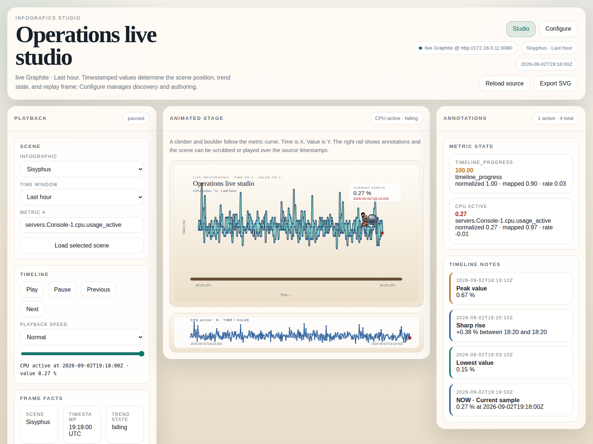
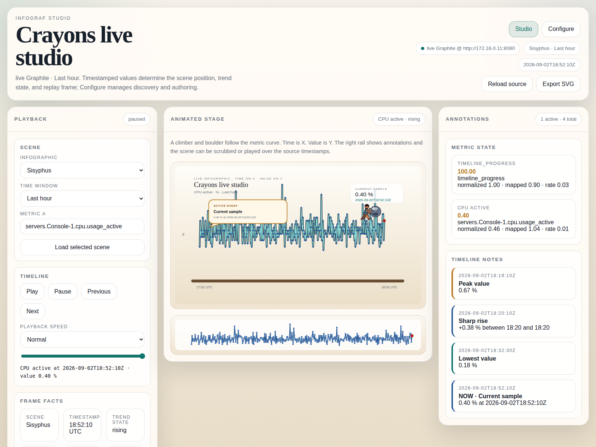

# Infografics

Infografics turns timestamped telemetry into deterministic animated infographics. Time, value, trend, and events are normalized first, then mapped to charts, characters, paths, scale, altitude, rotation, and other explicit scene properties.



## Included

- Go REST backend with an embedded Studio UI.
- SQLite control-plane store for configuration, saved dashboards, and revisions.
- Graphite discovery and replay with deterministic fallback data for unavailable or partial targets.
- Multi-metric scenes, saved dashboard switching, host overlays, labeled graph panels, timeline notes, and deterministic playback.
- Source adapters for Prometheus, CSV, XLSX worksheet templates, OpenTelemetry JSON, REST/JSON, and raw plaintext.
- Animation-ready sprite atlases with explicit provenance metadata.

## Quick start

```bash
./tools/bootstrap-toolchain.sh
PATH="$(pwd)/.tools/bin:$PATH"
go run ./cmd/infograf
```

Open <http://127.0.0.1:8080/>. Studio is the playback workspace. Dashboards & Configure manages saved views, source discovery, expressions, and persistence.

```bash
INFOGRAF_ADDR=127.0.0.1:18080 INFOGRAF_DB_PATH=/tmp/infograf-review.db go run ./cmd/infograf
```

## Connecting data sources

### Graphite

```bash
INFOGRAF_GRAPHITE_URL=http://graphite.example:8080 \
INFOGRAF_ADDR=127.0.0.1:8080 \
go run ./cmd/infograf
```

The Studio discovers common metric paths, accepts up to six metrics, and replays source timestamps. Empty or partial Graphite targets are replaced by deterministic fixture points and labeled accordingly.

### Canonical adapter API

Every adapter emits the same datasource-agnostic contract:

```http
POST /api/v1/sources/adapt
Content-Type: application/json

{"kind":"prometheus","source_ref":"prometheus-prod","payload":"cpu_usage{host=\"console-1\"} 42 1788350400000\n"}
```

The response contains `series[]` and `events[]`. Series retain exact metric names, semantics, units, numeric ranges, and ordered timestamp/value points.

Supported kinds:

| Kind | Payload | Notes |
| --- | --- | --- |
| `graphite` | Graphite HTTP source | Live catalog and demo replay. |
| `prometheus` | Prometheus text exposition | Labels and optional millisecond timestamps. |
| `csv` | RFC 4180 CSV | Timestamp column plus numeric metric columns. |
| `xlsx` | Selected worksheet as CSV bytes | Workbook extraction belongs in the upload boundary. |
| `opentelemetry` / `otlp` | OTLP JSON | Common gauge, sum, histogram, and exponential-histogram points. |
| `rest` / `rest/json` | Nested JSON | Finds `{metric|name, value, timestamp}` samples. |
| `plaintext` / `raw` | `metric value timestamp` lines | Simple exporters and shell probes. |

CSV example:

```csv
timestamp,console_1_cpu,console_2_cpu
2026-09-02T12:00:00Z,42,37
2026-09-02T12:01:00Z,44,39
```

Select both host metrics in one dashboard to compare them over the same playback window.

## Saved dashboards and overlays

1. Choose an infographic and time window.
2. Select up to six metrics, including metrics from different hosts.
3. Edit the visible heading and subtext directly, or use the Scene panel fields.
4. Click **Save this view**. The view is stored as a versioned SQLite scene document.
5. Switch views with **Saved dashboard** or **Dashboards & Configure**.

The animated stage uses the primary metric for character motion. The graph gallery renders every selected series with its own unit, value scale, time axis, and synchronized playback cursor, avoiding misleading mixed-unit overlays.

## Datastore configuration

Configure persists this declaration:

```json
{"storage":{"backend":"sqlite","path":"data/infograf.db","retention_days":30,"wal":true}}
```

SQLite is the current control-plane backend. `INFOGRAF_DB_PATH` overrides the configured path for a process; path changes take effect on the next start.

Environment variables:

- `INFOGRAF_ADDR` — HTTP listen address; default `:8080`.
- `INFOGRAF_DATA_DIR` — SQLite directory; default `data`.
- `INFOGRAF_DB_PATH` — explicit SQLite file path.
- `INFOGRAF_GRAPHITE_URL` — Graphite web host.

## Adding custom animation artwork

Place each asset under `internal/app/static/assets/generated/<asset>/`:

```text
<asset>-atlas.png
<asset>-atlas.json
```

The PNG is a horizontal frame strip per state, stacked vertically:

```text
atlas width  = cell.width × frames_per_state
atlas height = cell.height × number_of_states
```

| Asset | Cell | Frames/state | Atlas size | States |
| --- | ---: | ---: | ---: | --- |
| Sisyphus | 128×96 | 8 | 1024×288 | rising, steady, falling |
| Icarus | 160×112 | 8 | 1280×336 | rising, steady, falling |
| Cerberus | 192×144 | 8 | 1536×432 | rising, steady, falling |

Use transparent PNGs with consistent registration. The anchor is a meaningful motion root—contact foot, pelvis/chest, or body root—not the image corner. Keep character parts and annotation anchors addressable in source artwork before rasterizing.

Metadata example:

```json
{
  "image":"athena-atlas.png",
  "cell":{"width":160,"height":112},
  "frames_per_state":8,
  "states":{"rising":{"row":0,"fps":10},"steady":{"row":1,"fps":6},"falling":{"row":2,"fps":10}},
  "anchor":{"x":80,"y":72,"meaning":"pelvis/root"},
  "provenance":"Creator, source, and license information"
}
```

Frames are selected from source timestamp and backend scene state. Do not add timer-driven motion unrelated to a metric, event, trend, expression, or explicit rule. Record public-domain adaptations and third-party licenses in `docs/ASSET_LICENSES.md`.

## Development checks

```bash
./.tools/bin/go test ./...
npm --prefix frontend run build
git diff --check
```



